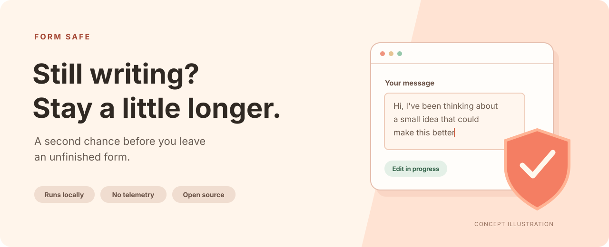

<p align="center">
  
</p>

<h1 align="center">Form Safe</h1>

<p align="center"><strong>A second chance before you leave an unfinished form.</strong></p>

<p align="center">
  <a href="https://chromewebstore.google.com/detail/form-safe/mhbeeoegononcomocnaekfibmjahmamk"></a>
  <a href="https://github.com/mikr13/form-safe/actions/workflows/ci.yml"></a>
  
  
  <a href="PRIVACY.md"></a>
  <a href="LICENSE"></a>
</p>

<p align="center">
  <a href="https://chromewebstore.google.com/detail/form-safe/mhbeeoegononcomocnaekfibmjahmamk">Install from Chrome Web Store</a> ·
  <a href="docs/DEVELOPMENT.md">Development</a> ·
  <a href="https://github.com/mikr13/form-safe/issues/new?template=bug_report.yml">Report a bug</a>
</p>



Form Safe is a free, open-source browser extension that asks your browser to warn you before leaving a page after you edit a form. An accidental back swipe, reload, or closed tab should not cost you the message you were still writing.

It runs locally, without an account, analytics, or a server. It does not save or recover drafts: when the browser shows its leave-page warning, choose **Stay** or **Cancel** to keep working.

## Why Form Safe?

- **Automatic:** watches standard form fields when a page loads, with no popup or setup screen.
- **Useful:** requests a warning on page unload after an edit, including navigation, reloads, and tab or window closes where the browser supports it.
- **Dynamic:** watches fields and forms added after the initial page load.
- **Local:** reacts to edit events without reading, storing, or transmitting field values.
- **Focused:** one content script, with no background service, account, or cloud dependency.

## Install

[](https://chromewebstore.google.com/detail/form-safe/mhbeeoegononcomocnaekfibmjahmamk)

1. Open the [Form Safe listing](https://chromewebstore.google.com/detail/form-safe/mhbeeoegononcomocnaekfibmjahmamk) in Chrome and choose **Add to Chrome**.
2. Confirm the installation and reload any pages that were already open.
3. Edit a standard form field and try the [quick check below](#try-it).

Chrome manages updates to the store-installed extension. Other Chromium browsers that support Chrome Web Store extensions can use the same listing; check behavior in your browser.

### Build from source

You need Git, [Bun](https://bun.sh), and Node.js 22.12 or later for the commands below. These are build tools; the installed extension runs in your browser.

```sh
git clone https://github.com/mikr13/form-safe.git
cd form-safe
bun install --frozen-lockfile
bun run build
```

#### Chrome, Edge, Brave, and other Chromium browsers

1. Open your browser's extensions page, such as `chrome://extensions` or `edge://extensions`.
2. Enable **Developer mode** and choose **Load unpacked**.
3. Select the `.output/chrome-mv3` directory inside this project.
4. Reload any pages that were already open so the content script can run.

Other Chromium browsers can load the Chrome build; check behavior in your specific browser. Keep the build directory in place while the extension is installed.

#### Firefox

```sh
bun run build:firefox
```

Open `about:debugging#/runtime/this-firefox`, choose **Load Temporary Add-on…**, and select `.output/firefox-mv2/manifest.json`. Reload your test page. Temporary add-ons are removed when Firefox restarts; permanent distribution requires Mozilla signing.

See [Development](docs/DEVELOPMENT.md) for live development and build archives.

## Try it

1. Open a regular HTTP or HTTPS page with a text input, text area, or select field.
2. Type into or change a field.
3. Try reloading, closing the tab, or navigating to a different page.
4. If your browser shows a leave-page warning, choose **Stay** or **Cancel** to continue editing.

The guard clears when any watched form on the page emits a `submit` or `reset` event. That event does not prove the website saved the data. See [Troubleshooting](docs/TROUBLESHOOTING.md) for missing or unexpected warnings.

## How it works

The content script finds `input`, `textarea`, and `select` elements, skipping hidden and submit inputs. An `input` or `change` event enables a page-level `beforeunload` listener. A `MutationObserver` watches for newly added fields and forms. Form submission or reset removes the listener.

The browser owns the confirmation dialog and decides whether to display it. Form Safe adds no custom dialog and does not inspect what you typed.

## Limits to know

- **Browser-controlled warnings.** Prior interaction is required, and session termination may bypass the warning. The browser supplies the message. See [MDN's `beforeunload` notes](https://developer.mozilla.org/en-US/docs/Web/API/Window/beforeunload_event).
- **Same-document navigation.** Single-page app routes and history changes that do not unload the document are not intercepted.
- **Standard fields only.** Rich-text editors using `contenteditable`, fields inside shadow DOM, and forms inside child frames are not watched by the current script.
- **Page-wide state.** Editing back to the original value does not clear the guard; submitting or resetting any watched form clears it for the whole page, even if another form still has edits.
- **Unknown save state.** The extension cannot detect successful autosave. Programmatic value changes may not produce the events it watches.
- **Restricted pages.** Browser-internal pages and other pages that block content scripts cannot be protected. Local `file://` pages are outside the current match pattern.

## Privacy

Form Safe listens for form edit events and tracks a boolean flag in page memory. It does not read field values, persist form contents, access browsing history, or make network requests. There is no analytics, telemetry, or remote configuration.

The script matches HTTP and HTTPS pages so it can watch forms across websites. The browser may describe this as permission to read and change site data; the actual behavior is limited to the content script described above. Read the [Privacy Policy](PRIVACY.md) for the exact boundary.

## Documentation

- [Development Guide](docs/DEVELOPMENT.md)
- [Troubleshooting](docs/TROUBLESHOOTING.md)
- [Privacy Policy](PRIVACY.md)
- [Release Process](RELEASING.md)
- [Changelog](CHANGELOG.md)
- [Contributing](CONTRIBUTING.md)
- [Security Reporting](SECURITY.md)

## Contributing

Bug reports, documentation improvements, and focused pull requests are welcome. Include your browser version and a minimal form that reproduces the problem. Keep real form contents and sensitive website data out of reports.

Start with [CONTRIBUTING.md](CONTRIBUTING.md). Have an idea? [Open a feature request](https://github.com/mikr13/form-safe/issues/new?template=feature_request.yml). Report vulnerabilities privately using [SECURITY.md](SECURITY.md).

## Built with

- [TypeScript](https://www.typescriptlang.org)
- [WXT](https://wxt.dev) for browser-extension development and packaging
- Standard DOM events, `MutationObserver`, and `beforeunload`
- [Bun](https://bun.sh) for dependency installation and project scripts

## License

Form Safe is available under the [MIT License](LICENSE). Copyright © 2025–2026 mikr13.
